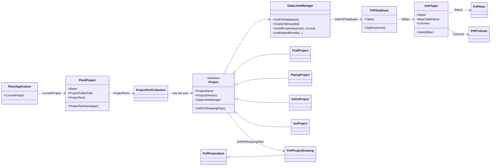
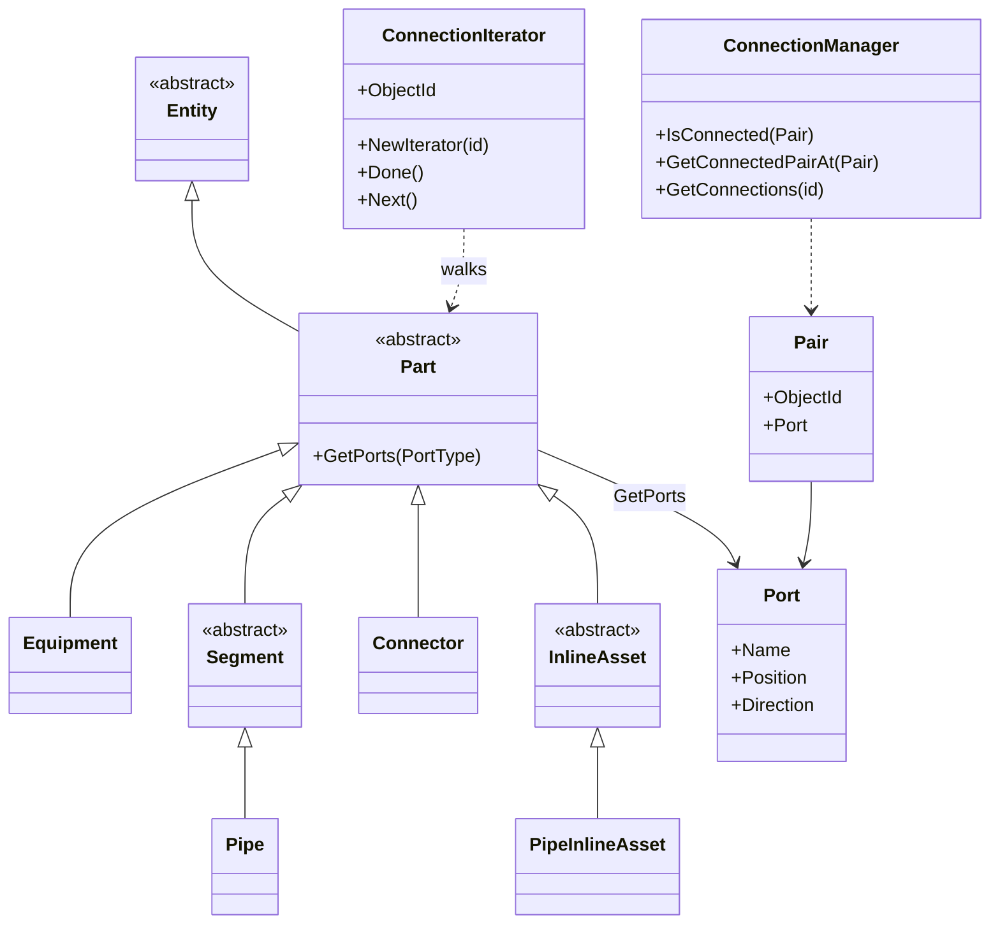

# 11a — Plant 3D .NET API architecture: layers, assemblies, namespaces, class hierarchy

> **Where these facts come from.** Autodesk publishes no online class reference for the Plant SDK, so this
> chapter is put together from primary sources, and every table says which one:
> **[T]** Autodesk's ADN *Plant3DTraining* course (labs + the class diagrams in its presentation, written for
> 2011–2015), **[D]** Autodesk's support article on the Plant 3D DLLs, **[B]** Autodesk Developer Blog samples
> (2024–2026), **[S]** Speckle's open-source Plant 3D connector, which compiles against the real 2026 and 2027
> assemblies, **[F]** Autodesk Community forum code, **[H]** Autodesk help. Links are in
> [Sources](#sources). Anything none of them shows is marked **VERIFY**.
> The command `P3DAPIMAP` ([last section](#see-the-real-hierarchy-on-your-pc)) prints the hierarchy of *your* installation.

This chapter is the map. [11](11-plant3d-sdk.md) is the task-oriented tour (line list, MTO, specs, isometrics),
[11b](11b-plant3d-first-addin.md) builds an add-in step by step, [11c](11c-plant3d-code-examples.md) explains the code.

## Contents
- [The big picture](#the-big-picture)
- [Assemblies and namespaces](#assemblies-and-namespaces)
- [Class hierarchy 1: application, project, data](#class-hierarchy-1-application-project-data)
- [Class hierarchy 2: 3D model entities](#class-hierarchy-2-3d-model-entities)
- [Class hierarchy 3: P&ID entities](#class-hierarchy-3-pid-entities)
- [Two hierarchies: .NET classes and project classes](#two-hierarchies-net-classes-and-project-classes)
- [Routes through the data](#routes-through-the-data)
- [Relationships](#relationships)
- [Events](#events)
- [See the real hierarchy on your PC](#see-the-real-hierarchy-on-your-pc)
- [Sources](#sources)

## The big picture

```
┌────────────────────────────────────────────────────────────────────────────────────┐
│ Your add-in DLL (C#, .NET 8)      [CommandMethod] commands, IExtensionApplication   │
├────────────────────────────────────────────────────────────────────────────────────┤
│ Plant SDK (.NET)                  namespace Autodesk.ProcessPower.*                 │
│   Project API      PlantApplication → PlantProject → Project (one per project part) │
│   Data API         DataLinksManager → PnPDatabase → PnPTable → PnPRow               │
│   3D entities      Part → Pipe, PipeInlineAsset, Connector, Equipment               │
│   P&ID entities    LineSegment, Asset, styles, annotations                          │
├────────────────────────────────────────────────────────────────────────────────────┤
│ AutoCAD .NET API                  namespace Autodesk.AutoCAD.*                      │
│   Application → Document → Database → Transaction → DBObject / Entity               │
├────────────────────────────────────────────────────────────────────────────────────┤
│ Storage     DWG files (geometry, handles)   +   project databases *.dcf (properties)│
└────────────────────────────────────────────────────────────────────────────────────┘
```

- An add-in is a DLL that runs **inside** the Plant 3D process. It uses two APIs at once: the AutoCAD .NET API for everything that is a drawing ([docs/10](10-autocad-dotnet-basics.md)) and the Plant SDK for everything that is *plant*.
- Plant 3D = AutoCAD + custom object classes + a project database. Geometry lives in the DWG, properties live in the database, and one class joins the two: **`DataLinksManager`** ([how the data is stored](11-plant3d-sdk.md#how-plant-3d-stores-data)).
- Autodesk's training describes the SDK as four components [T]:

| Component | Covers | Start here |
|---|---|---|
| **Project API** | the files and settings that make up a Plant project | `PlantApplication`, `PlantProject`, `Project` |
| **Data API** | object properties and project-wide relationships | `DataLinksManager`, `PnPDatabase` |
| **Plant 3D entities** | pipes, fittings, equipment in the 3D model | `Part` and its subclasses |
| **Drawing entities and objects** | P&ID lines, symbols and supporting objects | `LineSegment`, `Asset` |

- Languages [T]: .NET (C# or VB.NET) is the intended way. Unmanaged C++ works for the entity classes. **VBA, AutoLISP and COM cannot reach the Plant API** — which is why this repository uses LISP only for AutoCAD-level work.

## Assemblies and namespaces

| Namespace | Assembly | Key classes | Source |
|---|---|---|---|
| `Autodesk.ProcessPower.PlantInstance` | `PnPProjectManagerMgd.dll` | `PlantApplication` | [T] [B] |
| `Autodesk.ProcessPower.ProjectManager` | `PnPProjectManagerMgd.dll` | `PlantProject`, `Project` (abstract), `ProjectPartCollection`, `PnPProjectDrawing`, `PnPProjectItem`, `MiscProject`, `PnPProjectUtils` | [T] [B] [S] |
| `Autodesk.ProcessPower.P3dProjectParts` | `PnP3dProjectPartsMgd.dll` | `PipingProject`, `IsoProject` | [T] [B] |
| (P&ID project part) | `PnIdProjectPartsMgd.dll` | `PnIdProject` | [T] |
| (ortho project part) | `PnP3dOrthoProjectPart.dll` | `OrthoProject` | [T] |
| `Autodesk.ProcessPower.DataLinks` | `PnPDataLinks.dll` | `DataLinksManager`, `PpObjectId`, `PpObjectIdArray`, `DataLinkEventHandler`, `DataLinkEventArgs` | [T] [S] |
| `Autodesk.ProcessPower.DataObjects` | `PnPDataObjects.dll` | `PnPDatabase`, `PnPTable`, `PnPRow`, `PnPColumn`, `PnPRowIdArray` | [T] [B] [S] |
| `Autodesk.ProcessPower.Common` | `PnPCommonMgd.dll` | `PnPGenericNamedCollection<T>` — base class of the table and column collections | [T] |
| `Autodesk.ProcessPower.PnP3dObjects` | `PnP3dObjectsMgd.dll` | `Part`, `Pipe`, `PipeInlineAsset`, `Connector`, `Equipment`, `Port`, `PortCollection`, `PortType`, `Pair`, `ConnectionManager`, `ConnectionIterator`, `Connection` | [T] [B] [S] [F] |
| `Autodesk.ProcessPower.PnIDObjects` | `PnIDMgd.dll` | `LineSegment`, `Asset`, `LineObject`, `InlineEntity`, `LineObjectCollection`, `LineGroupManager`, `GroupType` | [T] [S] |
| `Autodesk.ProcessPower.Styles` | `PnPCommonDbxMgd.dll` | `Style`, `LineStyle`, `AssetStyle` | [T] [S] |
| `Autodesk.ProcessPower.PnPCommonDbx` | `PnPCommonDbxMgd.dll` | `FormatStringUtils`, `Annotation` | [T] |
| `Autodesk.ProcessPower.ProjectManagerUI` | `PnPProjectManagerUI.dll` | Project Manager user interface | [B] [D] |
| `Autodesk.ProcessPower.PnP3dPipeSupport`, `…ACPUtils` | `PnP3dPipeUI.dll`, `PnP3dACPUtils.dll` | `SupportHelper.GetSupportParameters`, `ParameterList` (pipe support dimensions) | [F] |

Where the files are (Plant 3D 2026, default install):

| Folder | DLLs | Source |
|---|---|---|
| `C:\Program Files\Autodesk\AutoCAD 2026\` (where `acad.exe` is) | `PnPDataObjects.dll`, `PnPDataLinks.dll` | [D] |
| same folder, reported for older releases | `PnPCommonMgd.dll`, `PnIdProjectPartsMgd.dll` | [T] |
| `C:\Program Files\Autodesk\AutoCAD 2026\PLNT3D\` | `PnPProjectManagerMgd.dll`, `PnPProjectManagerUI.dll` | [D] |
| same folder, expected (**VERIFY** with `P3DHELLO`) | the 3D libraries: `PnP3dObjectsMgd.dll`, `PnP3dProjectPartsMgd.dll`, `PnP3dPipeUI.dll`, `PnP3dACPUtils.dll` | — |
| Plant SDK `inc-x64\` | the .NET class libraries in one folder, plus help and samples | [T] |

- The DLLs ship with the product — [D] names the install folders, not the SDK — so a project can reference the installed files directly. The SDK download adds the help files and the samples.
- A DLL you cannot find: run `P3DHELLO` — it lists every loaded Plant 3D assembly with its version and folder.
- Reference all of them with **Copy Local = False**; Plant 3D loads its own copies ([11b, step 3](11b-plant3d-first-addin.md#step-3--reference-the-autocad-and-plant-3d-assemblies)).
- `PnPCommonMgd.dll`: you write no `using` for it, but the compiler asks for it (error CS0012) as soon as you touch `db.Tables[...]` or `table.Columns`, because their collection base class lives there [T].
- Classes named in the training without a namespace — `SpecManager`, `SpecPart`, `ContentManager`, `PipingObjectAdder`, `DataLinksManager3d` (spec lookup and part insertion) — find them with `P3DAPIMAP` or the Object Browser. **VERIFY** before you plan on them.

## Class hierarchy 1: application, project, data



| Class | What it is | Members seen in real code | Source |
|---|---|---|---|
| `PlantApplication` | the running Plant 3D application; one static entry point | `CurrentProject` (null when no project is open) | [T] |
| `PlantProject` | the whole project as shown in Project Manager. **Not** a `Project`: it *owns* the parts | `ProjectParts`, `ProjectPartName(part)`, `Name`, `ProjectFolderPath`; static `LoadProject(...)`, `Close()` for projects you open yourself | [T] [B] |
| `ProjectPartCollection` | the parts, by name: `["PnId"]`, `["Piping"]`, `["Ortho"]`, `["Iso"]`; also enumerable | indexer by name, `foreach (Project p in ...)` | [T] [B] |
| `Project` (abstract) | one project part = its settings + its drawings + its database. Derives from `XmlDocument`: a part *is* its settings XML | `ProjectName`, `ProjectDirectory`, `DataLinksManager`, `GetPnPDrawingFiles()` | [T] |
| `PnIdProject`, `PipingProject`, `OrthoProject`, `IsoProject` | typed parts with their own settings (for example `PipingProject.MinimumPipeLength`) | cast: `(PipingProject)prj.ProjectParts["Piping"]` | [T] |
| `PnPProjectDrawing` | one drawing registered in a part | `AbsoluteFileName` | [T] |
| `PnPProjectUtils` | static helpers | `GetActiveDocumentType()` → `"PnID"`, `"Piping"`, … | [S] |
| `DataLinksManager` | the DWG-object ↔ database-row link of **one part** | [member table in chapter 11](11-plant3d-sdk.md#datalinksmanager-members-seen-in-public-samples) | [T] [S] |
| `PnPDatabase` → `PnPTable` → `PnPRow`, `PnPColumn` | the project database: one table per project class, one row per object | `Tables[name]`, `Tables.Contains(name)`, `GetRow(id)`; `Select()`, `Select(filter)`, `BaseTableName`, `Columns`; `row[column]`, `row.Table` | [T] [B] [S] |

Reading the chain as a sentence: *the application has one current project; the project has parts; each part has
drawings and a links manager; the links manager opens the part's database; the database has a table per class.*

Two ways to work with the data, and when to use which [T]:

| | `DataLinksManager` | `PnPDatabase` / `PnPTable` / `PnPRow` |
|---|---|---|
| Level | high: "properties of this object", "objects related to that one" | low: tables, columns, rows, like ADO.NET |
| Values | name → value pairs, all **text** | typed column values |
| Good for | reading and writing properties of drawing objects | project-wide lists and filters, fast |
| Risk | low | higher: you can break what Plant expects — read freely, write through `DataLinksManager` |

## Class hierarchy 2: 3D model entities



`Entity` is AutoCAD's base class for everything drawn (`Autodesk.AutoCAD.DatabaseServices.Entity`); all the other
classes are in `Autodesk.ProcessPower.PnP3dObjects`. The inheritance arrows are the ADN class diagram [T].

| Class | In the model it is | Source |
|---|---|---|
| `Part` (abstract) | anything that takes part in piping. Every part has **ports** | [T] |
| `Pipe` | one straight piece of pipe | [T] [B] [S] |
| `PipeInlineAsset` | everything placed *in* a line from the spec: elbows, tees, reducers, flanges, valves, instruments | [T] [S] |
| `Connector` | the **joint** between two ports. Parts never touch directly: it is always *Part (port) – (port) Connector (port) – (port) Part*. A flanged joint between a pipe and a valve is the whole assembly weld – flange – bolt set – gasket | [T] |
| `Equipment` | tanks, pumps, vessels, exchangers. Nozzles are **sub-objects** of the equipment, not separate drawing objects | [T] [F] [H] |
| `Port` | a connection point: `Name` (`S1`, `S2`…), `Position` (`Point3d`), `Direction` (`Vector3d`) | [T] [B] |
| `PortType` | which ports to ask for: `All`, `Static`, `Symbolic` | [T] [B] [F] |
| `Pair` | one end of a connection = `ObjectId` + `Port` | [T] [B] |
| `ConnectionManager` | "is this port connected, and to what?" | [T] [B] |
| `ConnectionIterator` | walks from part to part through the joints | [T] |
| `Connection` | one joint as data: `ObjectId1`, `Port1`, `ObjectId2`, `Port2` | [B] |

Not in the diagram, because the public samples do not name their classes: pipe supports, steel structure,
insulation. They are Plant objects with database rows like the others, so the generic route in
[11c](11c-plant3d-code-examples.md) lists them; their .NET class names show up in `P3DCOMPONENTS` and `P3DAPIMAP`.

Two more names for the same object, both printed by `P3DINSPECT`:
- the **ObjectARX class** (`id.ObjectClass.Name`): the C++ class behind the .NET wrapper. A pipe reports `AcPpDb3dPipe` [F].
- the **project class** (`dlm.GetObjectClassname(id)`): the table in the project database — next section but one.

## Class hierarchy 3: P&ID entities

| Class | What it is | Members seen | Source |
|---|---|---|---|
| `LineSegment` | a schematic line ("SLINE"): pipe line or signal line segment | `Vertices`, `StyleID`, `ClassName`, `TagValue`, `GetLineObjectCollection(...)` | [T] [S] |
| `Asset` | a symbol: equipment, valve, instrument, nozzle; flow arrows are assets too. Behaves like a block reference | `ClassName`, `StyleId`, `BlockTableRecord` | [T] [S] |
| `LineObject` → `InlineEntity` | utility objects that describe what sits *on* a line: segments, gaps, inline symbols | `Position`; `InlineEntity.ObjectId` | [T] |
| `LineGroupManager` | finds the line group of a segment and all segments of a group. A line group has a database row but **no** DWG object | `GroupId(id)`, `Type(groupId)`, `LineDbIds(groupId)` | [T] |
| `Style` → `LineStyle`, `AssetStyle` | project-wide appearance, stored in each drawing and opened like any `DBObject` | `Name`, `ClassName` | [T] [S] |
| `Annotation` | helper for tag texts and annotation blocks; annotations are ordinary text or block references linked to the annotated object | `new Annotation(id)` | [T] |
| `FormatStringUtils` | evaluates tag format strings such as `#(TargetObject.Tag)` | `Evaluate(format, id)` | [T] |

The P&ID classes do not share a Plant base class the way the 3D classes share `Part`: treat each as an AutoCAD
`Entity` plus a database row [S]. For P&ID data work you rarely need them — the row is what matters.

## Two hierarchies: .NET classes and project classes

This is the point that confuses everyone at first.

| | .NET class hierarchy | Project class hierarchy |
|---|---|---|
| Answers | *how is it drawn and connected?* | *what is it?* |
| Lives in | the Plant 3D DLLs — fixed by Autodesk | the project database — editable in *Project Setup → Class Definitions* |
| Size | a handful: `Pipe`, `PipeInlineAsset`, `Connector`, `Equipment`… | hundreds: `Elbow`, `Tee`, `Valve`, `Pump`, `HandValve`… |
| You read it with | `obj.GetType()` after opening the object | `dlm.GetObjectClassname(id)`, then `PnPTable.BaseTableName` upwards until `PnPBase` |
| Example: a gate valve in the 3D model | `PipeInlineAsset` | `… > PipeRunComponent > … > Valve` |

- An elbow and a gate valve are the **same .NET class** (`PipeInlineAsset`). What differs is their project class and their property values.
- A project class is a **table**; a child class is a table whose `BaseTableName` names its parent [S]. A parent table lists the rows of all its children, which is why `PipeRunComponent` gives you every inline part at once.
- Top-level groups of project classes [H]: P&ID has *Engineering Items* (equipment, nozzles, instrumentation, inline assets, lines), *Non Engineering Items*, *Pipe Line Groups*, *Signal Line Groups*; Plant 3D has *P3D Line Group*, *Piping and Equipment* (equipment, pipe run components, fasteners) and *Steel Structure*. These are display names; the table names differ — list yours with `P3DTABLES`.
- So: filter by **.NET class** when you care about geometry ("all pipes"), by **project class** when you care about meaning ("all valves").

## Routes through the data

| Route | Start | Loop | Use it for | Sample |
|---|---|---|---|---|
| **A. Project database** | `part.DataLinksManager.GetPnPDatabase()` | `PnPTable.Select()` → rows | project-wide lists without opening drawings: line list, MTO, tag index | `P3DLINELIST`, `P3DMTO`, `P3DDUMP` ([Plant3DDataTools](../code/plant3d/csharp/Plant3DDataTools/)) |
| **B. Active drawing, object by object** | `Transaction` → model space | `HasLinks(id)` → `FindAcPpRowId(id)` → `GetAllProperties(rowId, true)` | "what is in *this* drawing", with handle, layer and .NET class | `P3DCOMPONENTS` ([Plant3DAddinStarter](../code/plant3d/csharp/Plant3DAddinStarter/)) |
| **C. Typed 3D part** | open the object as `Part` | `GetPorts(PortType.All)` | port names and positions | `P3DINSPECT` |
| **D. Connectivity** | `ConnectionManager`, `ConnectionIterator` | joint by joint | trace a line, find open ends | `P3DINSPECT`, `P3DWALK` |
| **E. Relationships** | `dlm.GetRelatedRowIds(...)` | row → related rows | line ↔ parts, line ↔ inline symbols | `P3DLINELIST`, `P3DINSPECT` |
| **F. Rows back to objects** | `dlm.FindAcPpObjectIds(rowId)` | `MakeAcDbObjectId(ppId)` | select or zoom to what a report row describes | [11c](11c-plant3d-code-examples.md#example-8--from-database-rows-back-to-drawing-objects) |
| **G. Project drawings** | `part.GetPnPDrawingFiles()` | `PnPProjectDrawing.AbsoluteFileName` | batch over all DWGs of a part | `P3DHELLO` (counts them) |
| **H. P&ID line structure** | `LineGroupManager`, `LineSegment.GetLineObjectCollection` | segments and inline objects | follow a P&ID line across its segments | ADN LAB 2 |

Rules that hold on every route:
- Route A reads the **whole project part**; routes B–D read **one open drawing**. Pick by scope.
- Orthographic drawings are different: the views are generated plain AutoCAD geometry, and a forum report says those objects carry no row ids [F]. Read the plant data from the 3D model drawing, not from the ortho.
- The three ids (`ObjectId`, row id / `PnPID`, `PpObjectId`) and their conversions: [chapter 11](11-plant3d-sdk.md#three-kinds-of-ids).
- Reading is safe. Writing: only through `DataLinksManager.SetProperties`, and read [Writing data safely](11-plant3d-sdk.md#writing-data-safely) first.

## Relationships

A relationship links two **rows** and has a type name and two role names. `GetRelatedRowIds(type, roleOfMyRow, myRowId, roleIWant)` follows it.

| Relationship type | Role → role | Source |
|---|---|---|
| `P3dLineGroupPartRelationship` | `LineGroup` ↔ `Part` (3D: line number ↔ its parts) | [S] |
| `PipeLineGroupRelationship` | `PipeLineGroup` ↔ `PipeLine` (P&ID) | [T] [S] |
| `SignalLineGroupRelationship` | `SignalLineGroup` ↔ `SignalLine` (P&ID) | [T] [S] |
| `LineInlineAsset`, `LineStartAsset`, `LineEndAsset` | `Line` ↔ `Asset` | [T] [B] |
| `LineFlowArrow` | `Line` ↔ `Arrow` | [T] [B] |
| `AssetOwnership` | `Owner` ↔ `Owned` (tank ↔ its nozzle) | [T] |
| `ConnectorsRelationship` | `Connector1` ↔ `Connector2` (P&ID: two linked off-page connectors — ask with both roles, you do not know which side your row is on) | [T] [B] |

Also predefined [T], role pairing not shown in the public material (**VERIFY**): `AnnotationRelationship`,
`SegmentBreak`, `LineOffPageConnector`, `LineNozzle`, `AssetNonEngineeringRelationship`; further role names:
`Annotated`, `Annotation`, `Break`, `OffPageConnector`, `Nozzle`, `NonEngineering`.

## Events

`DataLinksManager.DataLinkOperationOccurred` fires when rows change; the handler receives a
`DataLinkEventArgs` with `Action` and `RowId` (ADN LAB 5) [T]. Subscribe in a command or on first idle, never
in `Initialize` — the project may not be open yet ([11b](11b-plant3d-first-addin.md#step-4--implement-iextensionapplication)).

## See the real hierarchy on your PC

The tables above are assembled from samples. Your installation is the authority:

| Tool | Shows |
|---|---|
| `P3DAPIMAP` ([Plant3DAddinStarter](../code/plant3d/csharp/Plant3DAddinStarter/)) | every loaded Plant 3D assembly → namespaces → public types with base class, plus the inheritance tree of all DWG object classes, as a Markdown file. Type a class name (for example `DataLinksManager`) to list its members with signatures |
| `P3DINSPECT` | for one picked object: the real .NET inheritance chain, the ObjectARX class, the project class path |
| Visual Studio **Object Browser** (*View → Object Browser*) | the same, interactively, for the DLLs your project references |
| SDK help (`.chm` in the SDK `docs` folder) | Autodesk's reference: class lists with short descriptions |

Do this once per Plant 3D release and keep the `P3DAPIMAP` file next to your project: it replaces the class
reference Autodesk does not publish online, and a diff between two releases shows what changed.

## Sources

| Tag | Source |
|---|---|
| [T] | ADN [Plant3DTraining](https://github.com/ADN-DevTech/Plant3DTraining): `Labs/` (LAB 1–6) and `Presentation/Plant 3D 2015 .NET API.pptx` (API architecture, class diagrams, relationship list) |
| [D] | Autodesk support — [Which DLL-files are needed to create a plug-in for AutoCAD Plant 3D?](https://www.autodesk.com/support/technical/article/caas/sfdcarticles/sfdcarticles/Which-DLL-files-are-needed-to-create-a-plug-in-for-AutoCAD-Plant-3D.html) |
| [B] | Autodesk Developer Blog — [pipe port connections](https://blog.autodesk.io/retrieving-iso-arrow-symbols-and-pipe-port-connections/), [GetRelatedRowIds](https://blog.autodesk.io/using-getrelatedrowids-method/), [placing a valve on an SLINE](https://blog.autodesk.io/place-a-valve-on-an-sline-from-code-like-a-tool-palette-drop/), [linked off-page connectors](https://blog.autodesk.io/linking-from-one-off-page-connector-to-the-other-in-plant3d-pid/); sample [CLIPLANT360SHARE](https://github.com/MadhukarMoogala/CLIPLANT360SHARE) |
| [S] | [speckle-sharp-connectors](https://github.com/specklesystems/speckle-sharp-connectors) — `Converters/Plant3d` (Apache-2.0), built against Plant 3D 2026 and 2027 |
| [F] | Autodesk Community — [equipment and nozzle ports](https://forums.autodesk.com/t5/autocad-plant-3d-forum/create-equipment-subpart-via-api/m-p/8764564), [pipe support parameters](https://forums.autodesk.com/t5/net/p3d-support-properties/m-p/6492589), [drawing type of a database](https://forums.autodesk.com/t5/autocad-plant-3d-forum/api-how-to-read-and-change-drawing-properties-defined-at-the/td-p/12914063), [plant data in ortho drawings](https://forums.autodesk.com/t5/net-forum/accessing-plant-3d-support-properties-in-ortho-drawings-via-net/td-p/13823041) |
| [H] | Autodesk help — [class definitions for plant objects](https://help.autodesk.com/cloudhelp/2022/ENU/Plant3D-UserGuide/files/GUID-D46E7894-91F1-43FB-936D-E6F5DDB901EA.htm), [About Equipment](https://help.autodesk.com/cloudhelp/2015/ENU/Plant3D-UserGuide/files/GUID-ECB3FDEC-68E8-466B-B3C7-81630864C09A.htm) |

Next: [11b — Your first Plant 3D add-in, step by step](11b-plant3d-first-addin.md).
