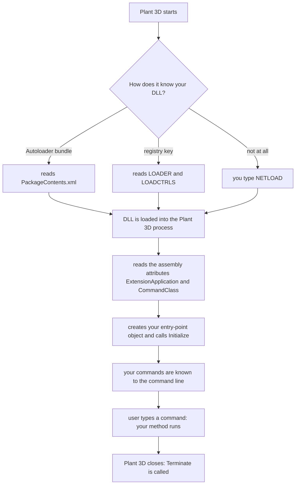

# 11b — Your first Plant 3D add-in, step by step

> **What you get.** A C# Class Library that Plant 3D loads by itself, with one entry-point class
> (`IExtensionApplication`) and one command. Every step is done twice here: by hand, so you understand it, and
> ready-made in [`code/plant3d/csharp/Plant3DAddinStarter`](../code/plant3d/csharp/Plant3DAddinStarter/), so you
> can compare.
> **Honesty.** The code in this chapter was compiled against stand-ins for the AutoCAD and Plant 3D assemblies
> (see [tools](../tools/README.md)); it has not been run inside Plant 3D. Loading rules are quoted from
> Autodesk's guides — tags like **[G]** point to [Sources](#sources). Unconfirmed items are marked **VERIFY**.

Read [10 — AutoCAD .NET basics](10-autocad-dotnet-basics.md) first (Document, Database, Transaction).
The API map is [11a](11a-plant3d-api-architecture.md); the code that reads plant data is [11c](11c-plant3d-code-examples.md).
New to C# itself? Do the beginner part of [19 — workbook](19-addin-learning-from-zero.md) first; [18](18-plant3d-addin-development.md)
is the learning path that grows the existing Plant3DDataTools project into a tool.

## Contents
- [What you are building](#what-you-are-building)
- [What "registering the DLL" means](#what-registering-the-dll-means)
- [Before you start](#before-you-start)
- [Step 1 — Create the Class Library project](#step-1--create-the-class-library-project)
- [Step 2 — Edit the project file](#step-2--edit-the-project-file)
- [Step 3 — Reference the AutoCAD and Plant 3D assemblies](#step-3--reference-the-autocad-and-plant-3d-assemblies)
- [Step 4 — Implement IExtensionApplication](#step-4--implement-iextensionapplication)
- [Step 5 — Add the first command](#step-5--add-the-first-command)
- [Step 6 — Build](#step-6--build)
- [Step 7 — Load it by hand and debug with F5](#step-7--load-it-by-hand-and-debug-with-f5)
- [Step 8 — Register the DLL so it loads by itself](#step-8--register-the-dll-so-it-loads-by-itself)
- [Step 9 — Check that it is loaded](#step-9--check-that-it-is-loaded)
- [Troubleshooting](#troubleshooting)
- [Checklist](#checklist)
- [Sources](#sources)

## What you are building



| Piece | What it is | File in the starter project |
|---|---|---|
| Class Library | a DLL: code without a `Main`. Plant 3D (`acad.exe`) is the program; your DLL lives inside it | `Plant3DAddinStarter.csproj` |
| Entry point | **one** class that implements `IExtensionApplication` — the "primary add-in interface" | `PlantAddin.cs` |
| Commands | public methods marked `[CommandMethod("NAME")]` | `*Commands.cs` |
| Loader information | bundle manifest **or** registry values | `bundle/PackageContents.xml`, `RegisterCommands.cs` |

## What "registering the DLL" means

An AutoCAD/Plant 3D .NET add-in is **not** a COM component. Nothing is registered with Windows.
"Registering" means: *tell Plant 3D where the DLL is, so it loads it without `NETLOAD`.*

| You may know this | Needed for a Plant 3D .NET add-in? |
|---|---|
| `regsvr32 my.dll` | No — that registers COM DLLs |
| `regasm` / *Register for COM interop* | No — only if LISP or VBA must call your classes through COM (rare) |
| Inventor `.addin` manifest ([docs/06](06-inventor-addins.md)) | No — that is Inventor's mechanism |
| **Autoloader bundle** (`PackageContents.xml`) | **Yes — recommended.** A folder; no registry editing |
| **Demand-loading registry key** (`…\Applications\<name>`) | **Yes — the classic way.** Four values under `HKEY_CURRENT_USER` |
| `[CommandMethod]` | automatic: each command is registered with the command line when the DLL loads |

Both real ways are in [step 8](#step-8--register-the-dll-so-it-loads-by-itself).

## Before you start

| Need | Check |
|---|---|
| Plant 3D installed and licensed | start it, open a sample project in Project Manager ([getting Plant 3D](00-getting-started.md#getting-autocad-plant-3d)) |
| Visual Studio 2022 (17.8 or newer) with the *.NET desktop development* workload | [docs/00](00-getting-started.md#install-checklist) |
| The DLL folders of your installation | [table in 11a](11a-plant3d-api-architecture.md#assemblies-and-namespaces) |
| Plant SDK (optional) | adds the help file and samples; the DLLs themselves ship with the product [D] |

One build per .NET generation — pick your row:

| Plant 3D | .NET inside | `TargetFramework` | NuGet `AutoCAD.NET` | Registry release | Bundle series |
|---|---|---|---|---|---|
| 2025 | .NET 8 | `net8.0-windows` | 25.0.x | `R25.0` | `R25.0` |
| **2026** | .NET 8 (.NET 10 after update 2026.1.2; still loads .NET 8 DLLs) | **`net8.0-windows`** | **25.1.0** | `R25.1` | `R25.1` |
| 2027 | .NET 10 | `net10.0-windows` | 26.0.0 | `R26.0` | `R26.0` |
| 2024 and older | .NET Framework 4.8 | `net48` | 24.x | `R24.x` | — not covered here |

(Version rows: [docs/00](00-getting-started.md#net-versions-in-one-table), [docs/10](10-autocad-dotnet-basics.md#project-setup-with-the-official-nuget-package).)

## Step 1 — Create the Class Library project

Visual Studio:
1. *Create a new project* → search **class library**.
2. Pick **Class Library** with the tags *C#*, *Windows*, *Library* — the one "for .NET or .NET Standard".
   - **Not** *Class Library (.NET Framework)*: that is .NET 4.8, for Plant 3D 2024 and older.
   - Not *WPF Class Library*, unless you plan palettes or dialogs — you can add WPF later.
3. Name `MyPlantAddin`, a short path without spaces (`C:\Dev\MyPlantAddin`).
4. Framework: **.NET 8.0** for Plant 3D 2025/2026. Visual Studio may label it *out of support* since November 2026 — choose it anyway; the product decides which .NET your DLL must target.
5. *Create*, then delete the generated `Class1.cs`.

Command line instead:

```powershell
dotnet new classlib -n MyPlantAddin -f net8.0
cd MyPlantAddin
del Class1.cs
```

## Step 2 — Edit the project file

Double-click the project in Solution Explorer and make it look like this (references come in step 3):

```xml
<Project Sdk="Microsoft.NET.Sdk">
  <PropertyGroup>
    <TargetFramework>net8.0-windows</TargetFramework>
    <PlatformTarget>x64</PlatformTarget>
    <OutputType>Library</OutputType>
    <Nullable>enable</Nullable>
    <ImplicitUsings>enable</ImplicitUsings>
    <!-- where Plant 3D is installed: change the year for another release -->
    <AcadDir>C:\Program Files\Autodesk\AutoCAD 2026</AcadDir>
  </PropertyGroup>
</Project>
```

| Line | Why |
|---|---|
| `net8.0-windows` | must match the .NET inside your Plant 3D release (table above) |
| `x64` | Plant 3D is 64-bit only |
| `Library` | a DLL, not an EXE |
| `Nullable` | the compiler warns where a value can be `null` — `MdiActiveDocument` and `CurrentProject` both can |
| `ImplicitUsings` | adds `using System; System.IO; System.Linq; System.Collections.Generic;` to every file. The sample code relies on it |
| `AcadDir` | your own property: one place for the install path, used by the references in step 3 |

The sample projects of this repository keep these lines in one shared file,
[`code/plant3d/Directory.Build.props`](../code/plant3d/Directory.Build.props).

## Step 3 — Reference the AutoCAD and Plant 3D assemblies

Add both groups inside `<Project>`:

```xml
  <ItemGroup>
    <!-- AutoCAD API from Autodesk's NuGet package: compile against it, never copy it to the output -->
    <PackageReference Include="AutoCAD.NET" Version="25.1.0" ExcludeAssets="runtime" />
  </ItemGroup>

  <ItemGroup>
    <!-- Plant 3D API from the install folder. Private=false is "Copy Local = No". -->
    <Reference Include="PnPProjectManagerMgd"><HintPath>$(AcadDir)\PLNT3D\PnPProjectManagerMgd.dll</HintPath><Private>false</Private></Reference>
    <Reference Include="PnPDataLinks"><HintPath>$(AcadDir)\PnPDataLinks.dll</HintPath><Private>false</Private></Reference>
    <Reference Include="PnPDataObjects"><HintPath>$(AcadDir)\PnPDataObjects.dll</HintPath><Private>false</Private></Reference>
    <Reference Include="PnPCommonMgd"><HintPath>$(AcadDir)\PnPCommonMgd.dll</HintPath><Private>false</Private></Reference>
  </ItemGroup>
```

| Reference | Gives you | Folder | Source |
|---|---|---|---|
| NuGet `AutoCAD.NET` | `acdbmgd`, `acmgd`, `accoremgd`: Application, Document, Database, Editor, `[CommandMethod]` | — | [docs/10](10-autocad-dotnet-basics.md#project-setup-with-the-official-nuget-package) |
| `PnPProjectManagerMgd.dll` | `PlantApplication`, `PlantProject`, `Project` | `…\AutoCAD 2026\PLNT3D\` | [D] |
| `PnPDataLinks.dll` | `DataLinksManager` | `…\AutoCAD 2026\` | [D] |
| `PnPDataObjects.dll` | `PnPDatabase`, `PnPTable`, `PnPRow` | `…\AutoCAD 2026\` | [D] |
| `PnPCommonMgd.dll` | base class of the table and column collections; without it: error CS0012 | `…\AutoCAD 2026\` (**VERIFY** — reported for older releases) | [T] |
| `PnP3dObjectsMgd.dll` — add it for [11c](11c-plant3d-code-examples.md) | `Part`, `Pipe`, `Port`, `ConnectionManager` | `…\PLNT3D\` expected (**VERIFY**) | [T] |

Rules:
- **Copy Local = No for every Autodesk DLL.** Plant 3D loads its own copies. A second copy next to your DLL causes load errors that are hard to read.
- Same in the Visual Studio UI: right-click *Dependencies* → *Add Project Reference…* → *Browse* → pick the DLLs; then select each reference → *Properties* → *Copy Local = No*. NuGet: *Manage NuGet Packages* → `AutoCAD.NET` by Autodesk → version 25.1.0, then add `ExcludeAssets="runtime"` in the project file.
- A file is not where the table says? Find it once:

```powershell
Get-ChildItem "C:\Program Files\Autodesk\AutoCAD 2026" -Recurse -Filter PnP*Mgd.dll | Select-Object FullName
```

- Never copy Autodesk DLLs into your repository or your installer ([docs/14](14-best-practices.md)).
- The starter project uses one folder for all Plant DLLs instead (`PlantSdkInc`: the SDK's `inc-x64`, or a folder you fill yourself). Both ways give the same build.

## Step 4 — Implement IExtensionApplication

What Autodesk's guide says [G]:

| Fact | Consequence |
|---|---|
| `IExtensionApplication` (namespace `Autodesk.AutoCAD.Runtime`) has two methods: `Initialize()` and `Terminate()` | implement both, even if one stays empty |
| It is **optional**: a DLL with only command classes loads too | add it when you need start-up or shut-down code |
| `Initialize()` runs once, when the DLL is loaded | set-up code |
| `Terminate()` runs when the program closes — a .NET DLL cannot be unloaded earlier | clean-up code; rebuild → restart Plant 3D |
| `[assembly: ExtensionApplication(typeof(X))]` names the entry point. Only **one** type per DLL; it must implement the interface | put it above the namespace |
| `[assembly: CommandClass(typeof(Y))]` names a class with commands. If you use it at all, declare it for **every** command class | one line at the top of each command file |
| Without these attributes AutoCAD searches every public type of the DLL | works, but slower for big DLLs — and the attributes document your intent |

Add a file `PlantAddin.cs`:

```csharp
using Autodesk.AutoCAD.Runtime;
using AcApp = Autodesk.AutoCAD.ApplicationServices.Application;

[assembly: ExtensionApplication(typeof(MyPlantAddin.PlantAddin))]

namespace MyPlantAddin
{
    public class PlantAddin : IExtensionApplication
    {
        public void Initialize()
        {
            try
            {
                AcApp.Idle += OnFirstIdle;      // Plant 3D is ready when it becomes idle for the first time
            }
            catch (System.Exception ex)
            {
                System.Diagnostics.Trace.WriteLine("MyPlantAddin: Initialize failed: " + ex);
            }
        }

        public void Terminate()
        {
            AcApp.Idle -= OnFirstIdle;
        }

        private static void OnFirstIdle(object? sender, EventArgs e)
        {
            AcApp.Idle -= OnFirstIdle;          // run once
            AcApp.DocumentManager.MdiActiveDocument?.Editor.WriteMessage("\nMyPlantAddin loaded. Command: MYHELLO\n");
        }
    }
}
```

Rules for `Initialize` — most "my add-in does not load" problems are broken here:

| Rule | Why |
|---|---|
| Never let an exception escape (`try`/`catch` around everything) | the load fails and all you see later is `Unknown command` |
| No drawing work, no Plant project work | with a bundle or the registry it runs **during start-up**: no drawing is open and `PlantApplication.CurrentProject` is not ready. Autodesk's own advice for demand loading: do nothing in `Initialize` [F] |
| Subscribe to events and return | start-up time of Plant 3D is your users' time |
| Need "after start-up"? Use `Application.Idle` once | it fires when the program is ready for input |
| No message boxes | they block an unattended start |
| The class is `public` and has no constructor parameters | AutoCAD creates the object itself |

Naming trap: `Autodesk.AutoCAD.Runtime` has its own `Exception` class. With `using System;` in scope (implicit usings), a bare
`Exception` is ambiguous (error CS0104) → always write `System.Exception` in AutoCAD code.

The starter's [`PlantAddin.cs`](../code/plant3d/csharp/Plant3DAddinStarter/PlantAddin.cs) adds one more thing: an
`AssemblyResolve` handler. If .NET cannot find a Plant 3D assembly because Plant 3D has not loaded it yet, the
handler looks in the folder of `acad.exe` and its `PLNT3D` subfolder. It only acts when Plant 3D is the running
program, so the add-in stays harmless in plain AutoCAD.

## Step 5 — Add the first command

Add a file `HelloCommands.cs`:

```csharp
using Autodesk.AutoCAD.ApplicationServices;
using Autodesk.AutoCAD.EditorInput;
using Autodesk.AutoCAD.Runtime;
using Autodesk.ProcessPower.PlantInstance;      // PlantApplication
using Autodesk.ProcessPower.ProjectManager;     // PlantProject, Project
using AcApp = Autodesk.AutoCAD.ApplicationServices.Application;

[assembly: CommandClass(typeof(MyPlantAddin.HelloCommands))]

namespace MyPlantAddin
{
    public class HelloCommands
    {
        [CommandMethod("MYHELLO")]
        public void Hello()
        {
            Document? doc = AcApp.DocumentManager.MdiActiveDocument;
            if (doc == null) return;
            Editor ed = doc.Editor;
            ed.WriteMessage($"\nDrawing: {doc.Name}");
            try
            {
                PrintProject(ed);               // all Plant 3D code is in that method - see below
            }
            catch (System.Exception ex)
            {
                ed.WriteMessage($"\nMYHELLO: {ex.GetType().Name}: {ex.Message}");
            }
            ed.WriteMessage("\n");
        }

        private static void PrintProject(Editor ed)
        {
            PlantProject? project = PlantApplication.CurrentProject;
            if (project == null) { ed.WriteMessage("\nNo Plant 3D project is open."); return; }

            ed.WriteMessage($"\nProject: {project.Name}  ({project.ProjectFolderPath})");
            foreach (Project part in project.ProjectParts)
                ed.WriteMessage($"\n  part: {project.ProjectPartName(part)}");
        }
    }
}
```

| Element | Rule |
|---|---|
| `[CommandMethod("MYHELLO")]` | the name typed at the command line. Upper case, no spaces, with **your own prefix** (`MY…`, company initials) so it never clashes with an Autodesk command |
| method | `public`, returns `void`, no parameters |
| class | `public`; listed in an `[assembly: CommandClass(...)]` line |
| instance method (as here) | AutoCAD creates one object of the class **per open drawing** → fields are per drawing. A `static` method shares its data between drawings [G] |
| `WriteMessage("\n…")` | start with `\n`, or your text is glued to the prompt |
| `MdiActiveDocument` | `null` when no drawing is open — test it |

Why the Plant code sits in its own method: .NET loads an assembly when the first method that uses it is
about to run. If `Hello()` itself used `PlantApplication`, a missing Plant assembly (plain AutoCAD) would
raise the error *before* `Hello()` starts — outside your `try`. In a separate method the error lands inside
the `try`, and the user gets one readable line. The starter wraps this pattern in
[`Report.Run`](../code/plant3d/csharp/Plant3DAddinStarter/Report.cs).

## Step 6 — Build

*Build → Build Solution* (Ctrl+Shift+B), or `dotnet build`. Result in `bin\Debug\net8.0-windows\`:

| File | Keep? |
|---|---|
| `MyPlantAddin.dll` | the add-in — this is what you load |
| `MyPlantAddin.pdb` | debug symbols; keep it next to the DLL to get line numbers in error messages |
| `MyPlantAddin.deps.json` | dependency list written by the build; leave it next to the DLL |
| `acdbmgd.dll`, `PnP*.dll`, … | **must not be there** → a reference has Copy Local on (step 3) |

- Zero errors, zero warnings is the goal; read warnings — `MSB3245` means a referenced DLL was not found.
- NuGet libraries of your own (ClosedXML…) are not copied next to a class library by default → add `<CopyLocalLockFileAssemblies>true</CopyLocalLockFileAssemblies>` to the project when you start using one.
- Use the *Debug* configuration while learning, *Release* for what you hand to colleagues.

## Step 7 — Load it by hand and debug with F5

First load, by hand:
1. Start Plant 3D, open a project and a drawing.
2. Type `NETLOAD` → pick `bin\Debug\net8.0-windows\MyPlantAddin.dll`.
3. If Plant 3D asks whether to load the file: your build folder is not a trusted location → *Options → Files → Trusted Locations* (system variable `TRUSTEDPATHS`). Do **not** switch `SECURELOAD` off ([docs/10](10-autocad-dotnet-basics.md#loading-netload-autoload-bundles-secureload)).
4. Type `MYHELLO`.

Debugger:
1. Project → *Properties* → *Debug* → *Open debug launch profiles UI* → new profile of type **Executable**.
2. Executable `C:\Program Files\Autodesk\AutoCAD 2026\acad.exe`, arguments `/product PLNT3D /language en-US` — copy them from the *Target* field of your Plant 3D desktop shortcut. Visual Studio saves this as `Properties\launchSettings.json` ([the starter's](../code/plant3d/csharp/Plant3DAddinStarter/Properties/launchSettings.json)).
3. Set a breakpoint in `Hello()` (F9), press **F5**: Plant 3D starts under the debugger.
4. `NETLOAD` the DLL, run the command → Visual Studio stops at the breakpoint. F10 steps, hover shows values.

| Fact | Consequence |
|---|---|
| A loaded .NET DLL cannot be unloaded | close Plant 3D before every rebuild, or the build fails with `MSB3027` (file locked by `acad.exe`) |
| NETLOAD lasts one session | type it again after each start — or continue with step 8 |
| *Debug → Windows → Modules* lists every loaded DLL with its path | use it when you are not sure **which copy** of your DLL is running |

## Step 8 — Register the DLL so it loads by itself

| | `NETLOAD` | **Autoloader bundle** | Registry key |
|---|---|---|---|
| Loads at program start | no | yes | yes |
| Set-up | none | a folder with one XML file | four registry values |
| Several releases | — | one bundle, `SeriesMin`/`SeriesMax` | one key **per release and language** |
| Limited to Plant 3D by | you | `Platform="Plant3D"` | the key sits under the Plant 3D product |
| Remove | restart | delete the folder | delete the key |
| Admin rights | no | no (per-user folder) | no (`HKEY_CURRENT_USER`) |
| Use it for | development | **deployment** | existing installers, a DLL on a share |

Use **one** of the two automatic ways for a given DLL. With both you no longer know which copy is running.

### Way A — Autoloader bundle (recommended)

```
%APPDATA%\Autodesk\ApplicationPlugins\
  MyPlantAddin.bundle\
    PackageContents.xml
    Contents\
      MyPlantAddin.dll
```

`PackageContents.xml`:

```xml
<?xml version="1.0" encoding="utf-8"?>
<ApplicationPackage SchemaVersion="1.0" AutodeskProduct="AutoCAD" ProductType="Application"
                    Name="MyPlantAddin" AppVersion="1.0.0"
                    ProductCode="{PUT-A-NEW-GUID-HERE}" UpgradeCode="{AND-ANOTHER-ONE-HERE}">
  <Components>
    <RuntimeRequirements OS="Win64" Platform="Plant3D" SeriesMin="R25.0" SeriesMax="R25.1" />
    <ComponentEntry AppName="MyPlantAddin" Version="1.0.0"
                    ModuleName="./Contents/MyPlantAddin.dll"
                    LoadOnAutoCADStartup="True">
      <Commands GroupName="MYPLANT">
        <Command Global="MYHELLO" Local="MYHELLO" />
      </Commands>
    </ComponentEntry>
  </Components>
</ApplicationPackage>
```

| Attribute | Meaning |
|---|---|
| `Platform="Plant3D"` | only AutoCAD Plant 3D loads the bundle; plain AutoCAD ignores it. `AutoCAD*` = every AutoCAD-based product; several values are joined with a vertical bar [C] |
| `SeriesMin` / `SeriesMax` | first and last release: `R25.0` = 2025, `R25.1` = 2026, `R26.0` = 2027. Leave one out and the range is open on that side [C] |
| `ModuleName` | the DLL, relative to the bundle folder |
| `LoadOnAutoCADStartup="True"` | load when the program starts. `LoadOnCommandInvocation="True"` instead: load when one of the listed commands is typed for the first time |
| `<Commands>` | `Global` = the name in `[CommandMethod]`. Needed for load-on-command; good documentation in any case |
| `ProductCode`, `UpgradeCode` | two GUIDs (Visual Studio: *Tools → Create GUID*). New `ProductCode` per version, `UpgradeCode` stays ([docs/14](14-best-practices.md#bundles-and-packagecontentsxml)) |

Install, by hand or by script:

```powershell
$bundle = "$env:APPDATA\Autodesk\ApplicationPlugins\MyPlantAddin.bundle"
New-Item -ItemType Directory -Force "$bundle\Contents" | Out-Null
Copy-Item .\PackageContents.xml $bundle -Force
Copy-Item .\bin\Release\net8.0-windows\MyPlantAddin.dll "$bundle\Contents" -Force
```

- Start Plant 3D: at start-up the program checks the `ApplicationPlugins` folders and loads what the XML describes [C].
- Folders: `%APPDATA%\Autodesk\ApplicationPlugins` (you only, no admin rights) or `C:\Program Files\Autodesk\ApplicationPlugins` (all users; the place Autodesk recommends [C]). The old `C:\ProgramData\…` folder is obsolete in 2026 ([docs/10](10-autocad-dotnet-basics.md#loading-netload-autoload-bundles-secureload)).
- Update: close Plant 3D, overwrite the DLL. Remove: close Plant 3D, delete the `.bundle` folder.
- Two .NET generations in one bundle: two `<Components>` blocks, each with its own `RuntimeRequirements` (`R25.0`–`R25.1` → a `net8.0-windows` DLL, `R26.0` → a `net10.0-windows` DLL) and its own `ModuleName` subfolder.
- The starter does all of this with one command — `dotnet build -c Release -p:DeployBundle=true` — through a small build target in [its project file](../code/plant3d/csharp/Plant3DAddinStarter/Plant3DAddinStarter.csproj) and [its manifest](../code/plant3d/csharp/Plant3DAddinStarter/bundle/PackageContents.xml).

### Way B — Demand-loading registry key

Plant 3D reads this key at start-up [G]:

```
HKEY_CURRENT_USER\Software\Autodesk\AutoCAD\<release>\<product>:<language>\Applications\<your add-in>
```

| Value | Type | Content |
|---|---|---|
| `DESCRIPTION` | text | anything readable |
| `LOADCTRLS` | number | **when** to load — sum of the flags below |
| `LOADER` | text | full path of the DLL |
| `MANAGED` | number | `1` = .NET DLL |

| `LOADCTRLS` flag | Load… [R] |
|---|---|
| 1 | when a drawing with custom objects of this application is opened |
| 2 | when the program starts |
| 4 | when an unknown command is typed that the key lists under a `Commands` subkey |
| 8 | on request |
| 16 | never (disabled) |
| 32 | transparently |

Autodesk's sample writes **14** (2 + 4 + 8) [G]. With the 2 in it the DLL loads at every start, so no `Commands` subkey is needed.

Which `<release>\<product>:<language>`?

| Plant 3D | Key below `Software\Autodesk\AutoCAD\` | Source |
|---|---|---|
| 2021 | `R24.0\ACAD-4117:409` | [K] |
| 2022 | `R24.1\ACAD-5117:409` | [K] |
| 2023 | `R24.2\ACAD-6117:409` | [K] |
| **2026** | `R25.1\ACAD-9117:409` | [K] |
| 2024, 2025, 2027 | same pattern expected: `R24.3\ACAD-7117`, `R25.0\ACAD-8117`, `R26.0\ACAD-A117` | **VERIFY** with `P3DHELLO` |

- `:409` is the English product. Other languages have another number (Japanese: `411`).
- So **do not type the key in code.** Ask the running program: `HostApplicationServices.Current.UserRegistryProductRootKey` returns `Software\Autodesk\AutoCAD\R25.1\ACAD-9117:409` for exactly the product, release and language that is running. `P3DHELLO` prints it.

The pattern from Autodesk's guide [G], as used in the starter's
[`RegisterCommands.cs`](../code/plant3d/csharp/Plant3DAddinStarter/RegisterCommands.cs):

```csharp
using Win32 = Microsoft.Win32;      // alias: Autodesk.AutoCAD.Runtime has its own Registry and RegistryKey classes

string key = HostApplicationServices.Current.UserRegistryProductRootKey + @"\Applications\MyPlantAddin";
using (Win32.RegistryKey app = Win32.Registry.CurrentUser.CreateSubKey(key))
{
    app.SetValue("DESCRIPTION", "My first Plant 3D add-in", Win32.RegistryValueKind.String);
    app.SetValue("LOADCTRLS", 14, Win32.RegistryValueKind.DWord);
    app.SetValue("LOADER", System.Reflection.Assembly.GetExecutingAssembly().Location, Win32.RegistryValueKind.String);
    app.SetValue("MANAGED", 1, Win32.RegistryValueKind.DWord);
}
```

- In the starter: `NETLOAD` the DLL once → `P3DREGISTER`. From then on Plant 3D loads it at every start. `P3DUNREGISTER` removes the key.
- The same as a `.reg` file (double-click to import; `0e` hex = 14):

```
Windows Registry Editor Version 5.00

[HKEY_CURRENT_USER\Software\Autodesk\AutoCAD\R25.1\ACAD-9117:409\Applications\MyPlantAddin]
"DESCRIPTION"="My first Plant 3D add-in"
"LOADCTRLS"=dword:0000000e
"LOADER"="C:\\Tools\\MyPlantAddin\\MyPlantAddin.dll"
"MANAGED"=dword:00000001
```

Limits of the registry way:
- `LOADER` is an absolute path: move or rename the folder → register again.
- One key per release and language: after an upgrade to the next Plant 3D the add-in is "gone" until you register (and rebuild) for that release.
- The key lives in the user's product settings; check it after a settings reset or a reinstall.
- `HKEY_LOCAL_MACHINE` has the same key for all users, but writing it needs admin rights. Use one hive, not both.
- The folder of the DLL must be a trusted location, or Plant 3D asks at every start.

## Step 9 — Check that it is loaded

| Check | Expect |
|---|---|
| start Plant 3D, open a drawing | `MyPlantAddin loaded. Command: MYHELLO` on the command line |
| type `MYHELLO` | the drawing name, the project name and its parts |
| bundle: type `APPAUTOLOADER` → `List` | your bundle in the list of installed plug-ins [C] |
| registry: `regedit` → the key above | four values; `LOADER` points to an existing file |
| starter: `P3DHELLO` | release, registry key, .NET runtime, project, parts, loaded Plant 3D DLLs with their folders |

Next: read data — [11c](11c-plant3d-code-examples.md).

## Troubleshooting

| Symptom | Cause | Fix |
|---|---|---|
| `Unknown command "MYHELLO"` | DLL not loaded; or `Initialize` threw; or the class has no `[assembly: CommandClass]` line while other classes have one; or class/method not `public` | `NETLOAD` it by hand and read the command line; check the four causes in this order |
| NETLOAD: "Could not load file or assembly … or one of its dependencies" | built for the wrong .NET (a `net10.0` DLL in 2025, a `net48` DLL in 2026) | `TargetFramework` from the table in [Before you start](#before-you-start) |
| nothing loads from a downloaded zip | Windows marked the files as blocked | `Get-ChildItem -Recurse \| Unblock-File` ([docs/13](13-errors-and-fixes.md#security-blocked-files-secureload-access-denied)) |
| bundle is ignored | wrong folder; XML not well-formed; `SeriesMin`/`SeriesMax` exclude your release; you started plain AutoCAD and the bundle says `Plant3D`; `ModuleName` path wrong; `APPAUTOLOAD` is 0 (default 14) [C] | check each; `APPAUTOLOADER` → `Reload` |
| registry: DLL does not load | key under another release, product or language; `LOADER` path outdated; `LOADCTRLS` without the 2 and no `Commands` subkey | `P3DHELLO` shows the right key; register again |
| registry with load-on-command only: `Unknown command` | `DEMANDLOAD` is 0 or 1 (default 3) [O], or the `Commands` subkey is missing | include flag 2, or use a bundle |
| build: `CS0246 … 'ProcessPower' could not be found` (and warning `MSB3245`) | a Plant DLL is not at its `HintPath` | find the file (step 3) and fix the path |
| build: `CS0012 … PnPGenericNamedCollection … not referenced` | `PnPCommonMgd.dll` missing | add the reference |
| build: `CS0104 'Exception' is an ambiguous reference` (also `Registry`, `RegistryKey`) | AutoCAD's `Runtime` namespace has classes with these names | `System.Exception`; `using Win32 = Microsoft.Win32;` |
| build: `MSB3027` / `MSB3021` cannot copy the DLL | Plant 3D is running and holds the file | close Plant 3D, build again |
| build: warning `NETSDK1138` (target framework out of support) | .NET 8 reached its end of support in November 2026; Plant 3D 2025/2026 still need it | ignore, or `<CheckEolTargetFramework>false</CheckEolTargetFramework>` |
| load error naming `acdbmgd` / `acmgd` | Autodesk DLLs were copied next to yours | `ExcludeAssets="runtime"`, `Private=false`; delete `bin` and `obj`, rebuild |
| command runs, then "Could not load file or assembly 'PnP…'" | plain AutoCAD; or a Plant DLL that Plant 3D has not loaded yet | run in Plant 3D; add the `AssemblyResolve` handler from the starter |
| old code still runs after a rebuild | Plant 3D was not restarted, or another copy of the DLL is loaded (bundle **and** registry) | restart; *Debug → Windows → Modules* shows the path |
| Plant 3D asks "load this file?" at every start | folder not trusted | `TRUSTEDPATHS`, or deploy as a bundle |

More: [13 — Errors and fixes](13-errors-and-fixes.md#autocad--plant-3d-net-errors).

## Checklist

- [ ] Class Library, `TargetFramework` matches the Plant 3D release, `x64`
- [ ] `AutoCAD.NET` with `ExcludeAssets="runtime"`; every Plant DLL with `Private=false`
- [ ] one `[assembly: ExtensionApplication]`; one `[assembly: CommandClass]` per command class
- [ ] `Initialize`: `try`/`catch`, no drawing or project work
- [ ] every command name has your prefix; every command tests `MdiActiveDocument` for `null`
- [ ] Plant code in its own method, inside a `try`
- [ ] no Autodesk DLL in the output folder
- [ ] loads with `NETLOAD`, then with **one** automatic way (bundle *or* registry)
- [ ] tested on a **copy** of a project before colleagues get it

## Sources

| Tag | Source |
|---|---|
| [G] | Autodesk help, AutoCAD .NET Developer's Guide — [Application Initialization and Load-Time Optimization (.NET)](https://help.autodesk.com/cloudhelp/2021/ENU/OARX-DevGuide-Managed/files/GUID-FA3B4125-F7BD-4E89-969F-9DCC90AC6977.htm), [Distribute Your Application (.NET)](https://help.autodesk.com/cloudhelp/2015/ENU/AutoCAD-NET/files/GUID-70D60274-57E0-4B22-8D0C-3C7F212A7CAF.htm) (demand-loading sample, unchanged in the 2026 and 2027 guides), topic *Command Definition (.NET)* (instance and static command methods) |
| [R] | Autodesk help, managed class reference — [ApplicationLoadReasons enumeration](https://help.autodesk.com/cloudhelp/2020/ENU/OARX-ManagedRefGuide/files/OARX-ManagedRefGuide-Autodesk_AutoCAD_DatabaseServices_ApplicationLoadReasons.html) |
| [C] | Autodesk help, Customization Guide — [PackageContents.xml reference](https://help.autodesk.com/cloudhelp/2025/ENU/AutoCAD-Customization/files/GUID-BC76355D-682B-46ED-B9B7-66C95EEF2BD0.htm), [RuntimeRequirements element](https://help.autodesk.com/cloudhelp/2025/ENU/AutoCAD-Customization/files/GUID-1591CA01-EF87-48CD-952B-772FE26037F1.htm), [About Installing and Uninstalling Plug-In Applications](https://help.autodesk.com/cloudhelp/2025/ENU/AutoCAD-Customization/files/GUID-5E50A846-C80B-4FFD-8DD3-C20B22098008.htm), [APPAUTOLOAD system variable](https://help.autodesk.com/cloudhelp/2015/ENU/AutoCAD-Core/files/GUID-33E75B9A-93AC-4FBF-B941-0F99A6AC3617.htm) |
| [O] | Autodesk help, ObjectARX Developer's Guide — [The DEMANDLOAD System Variable](https://help.autodesk.com/cloudhelp/2018/PLK/OARX-DevGuide/files/GUID-50C05E4A-6BAD-42F4-8DC4-48796D81DC7E.htm) |
| [D] | Autodesk support — [Which DLL-files are needed to create a plug-in for AutoCAD Plant 3D?](https://www.autodesk.com/support/technical/article/caas/sfdcarticles/sfdcarticles/Which-DLL-files-are-needed-to-create-a-plug-in-for-AutoCAD-Plant-3D.html) |
| [T] | ADN [Plant3DTraining](https://github.com/ADN-DevTech/Plant3DTraining) labs — project references, `PnPCommonMgd` |
| [F] | Autodesk Community — [AutoCAD 2014 - Automatic dll loading](https://forums.autodesk.com/t5/net-forum/autocad-2014-automatic-dll-loading/m-p/4581325) (Autodesk developer support on demand loading and `Initialize`) |
| [K] | Registry keys — Autodesk Community, [regroot for Plant 3D 2021–2023](https://forums.autodesk.com/t5/autocad-plant-3d-forum/what-to-put-in-regroot-for-plant-2024-and-2025-version/td-p/13010147); IMAGINiT, [Plant 3D 2026.2 update issues](https://resources.imaginit.com/support-blog/autocad-plant-3d-2026-2-update-issues) (2026 key); CAD Forum, [Autodesk product table](https://www.cadforum.cz/en/products.asp?ver=2026) (release numbers of AutoCAD itself) |

Next: [11c — Plant 3D code examples](11c-plant3d-code-examples.md).
